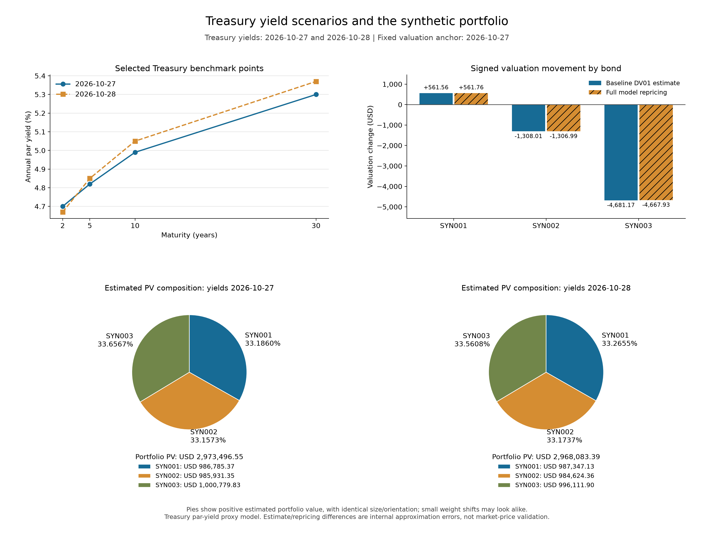

# CIO Macro Review — first milestone snapshot

A Python learning project that asks: **How would a change in Treasury yields affect a small fixed-rate bond portfolio?**

This frozen snapshot records the P013 charting milestone on November 1, 2026. It was developed with Codex assistance: Christian specified the financial questions, reviewed/refined the prompts, prepared the synthetic holdings, and reviewed outputs; Codex assisted with implementation and validation. This is a record of that workflow and progress, rather than a claim of unaided Python authorship.



## What this version does

- Reads an official Treasury CSV snapshot and three fictional bond holdings from Excel.
- Compares October 27 and October 28, 2026 yields at selected benchmark maturities.
- Calculates each holding's present value under both yield scenarios.
- Stores signed dollar/percentage changes and dated portfolio weights in nested dictionaries.
- Calculates modified duration, DV01 and baseline +/-1 bp price sensitivity.
- Compares a baseline-DV01 estimate of the change with full model repricing.
- Saves a four-panel chart with yield curves, signed dollar changes and two portfolio-composition pies.

| Estimated portfolio value | USD |
|---|---:|
| October 27 yields | 2,973,496.55 |
| October 28 yields | 2,968,083.39 |
| Signed change | -5,413.16 |

The corresponding portfolio change is approximately -0.182047%. These figures come from the captured development run; money is rounded here for presentation.

## Run locally

Use Python 3.13 (the recorded development interpreter was 3.13.15). From this repository:

```bash
python3 -m venv .venv
source .venv/bin/activate
python -m pip install -r requirements.txt
python main.py --no-show
```

On Windows, activate with `.venv\Scripts\activate` instead. The `--no-show` option saves the PNG without opening an image viewer. On macOS, `python main.py` also opens the saved figure in the default viewer. Each run prints the figure path and creates a fresh folder under `outputs/P013/`. Inputs resolve relative to `main.py`, not the terminal directory.

The original input files are included in `data/raw/`; see their [provenance and column definitions](data/raw/README.md). The example above is the saved milestone figure; a new run generates its own copy.

## Model and interpretation

Both scenarios retain the **October 27, 2026 valuation anchor** and the same cash flows. The second case substitutes October 28 yields; it does not advance settlement or measure a realized one-day holding-period return.

The fictional USD bonds have semiannual coupons and repay principal at maturity. Each bond uses its matched Treasury **par yield as one discount-yield proxy**. This is a simplified educational model: the values are not observed bond prices or a valuation from a bootstrapped spot curve. Credit/liquidity spreads, default, calls, inflation adjustment, taxes and transaction costs are excluded.

Portfolio duration uses same-scenario market-value weights; portfolio DV01 sums full-position bond DV01. The approximation uses each bond's own benchmark-yield change because the observed changes are nonparallel. The residual measures first-order approximation error within this model. Pie slices show positive estimated portfolio value, not contributions to a loss.

## Snapshot status

The saved source ran successfully and generated the illustrated PNG, which was opened and inspected. Earlier valuation/weight/risk checks are recorded in the development history. At the point frozen here, the final P013 independent chart-binding verification was still pending after a permission-related checking failure; **this snapshot does not claim that every independent check passed**. See the [verification summary](docs/VERIFICATION.md).

The queued Excel-report feature is not included in this milestone. Future changes remain in the separate development project; this repository is intended to be archived after publication.

See [progress and Codex workflow](docs/PROGRESS.md) and the [snapshot manifest](SNAPSHOT.json) for scope and source fingerprints.
